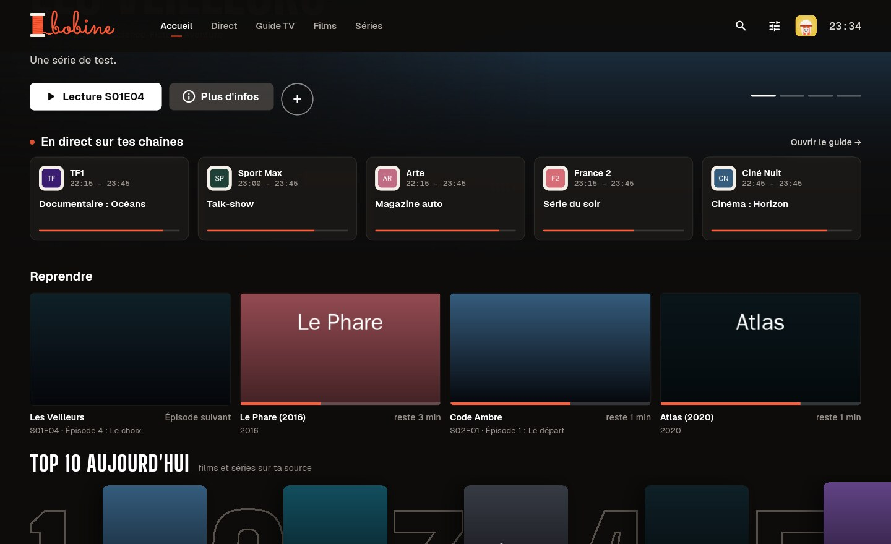
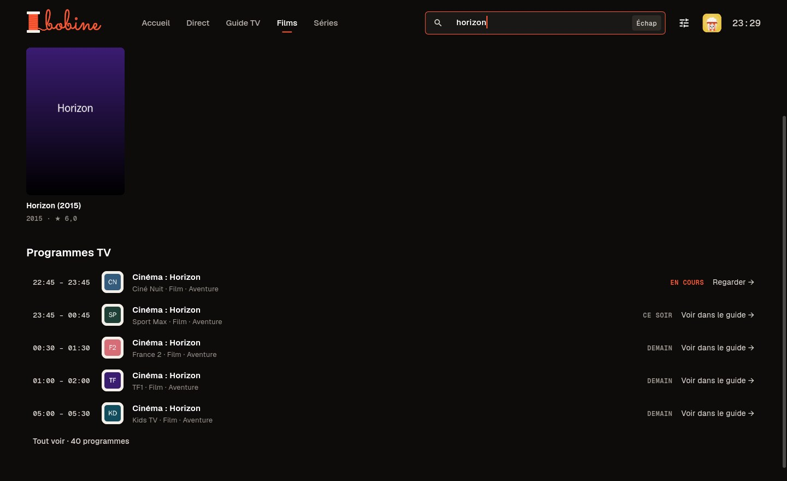
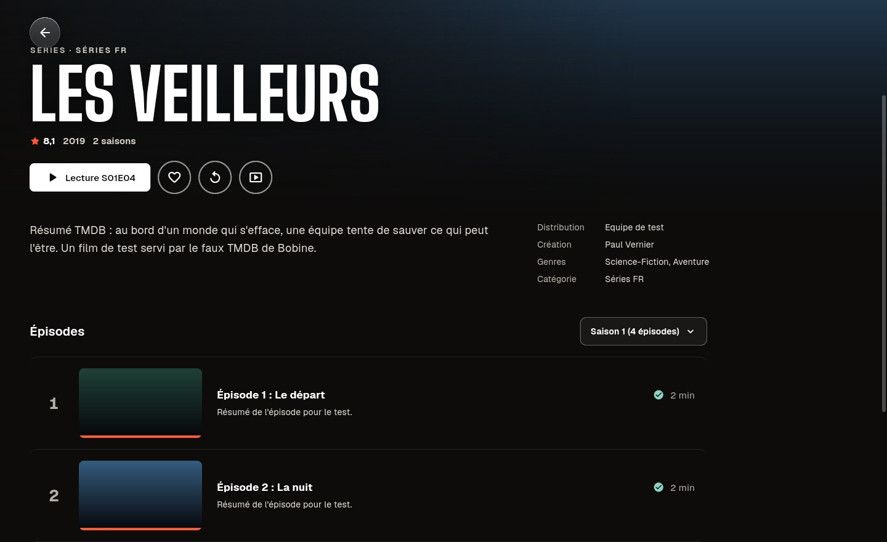
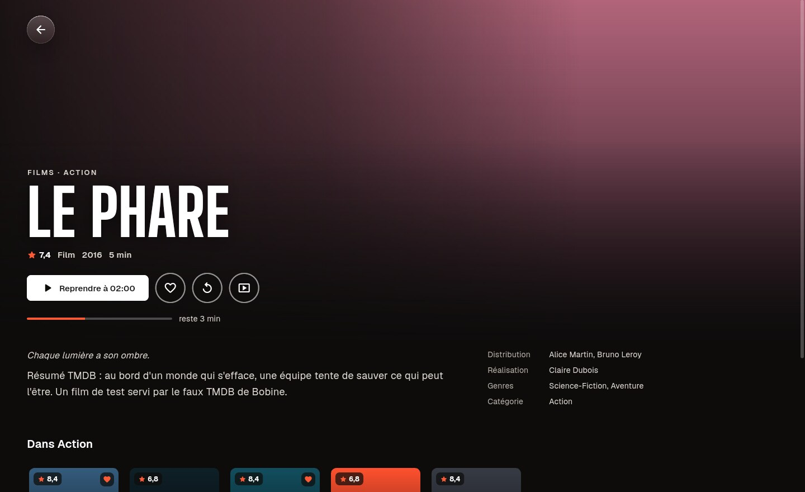
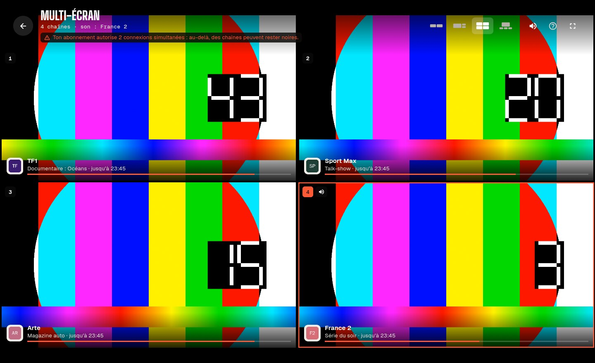
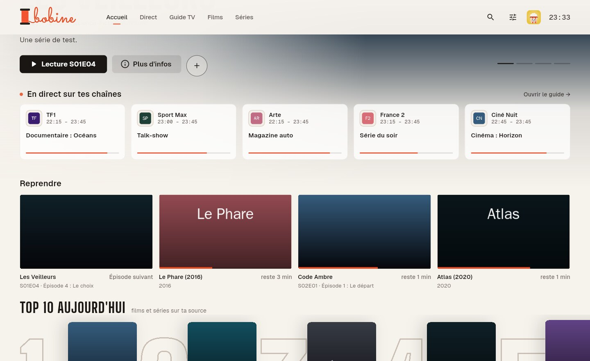
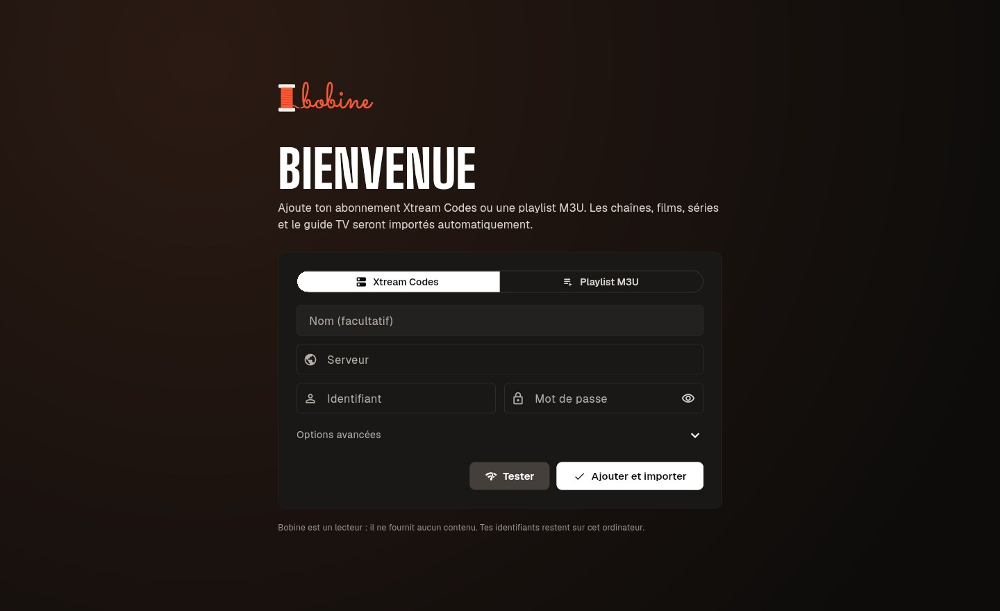

# Bobine, lecteur IPTV desktop

Lecteur IPTV pour **Windows, macOS et Linux**, construit avec Flutter et le moteur vidéo **libmpv** (via [media_kit](https://github.com/media-kit/media-kit)).
L'objectif : un lecteur **très optimisé**, qui lit à peu près tous les flux et sur lequel les avances / retours rapides sont instantanés.

> **Bobine est uniquement un lecteur.** Il ne fournit aucune chaîne, aucun film, aucune série ni aucune playlist : tu y ajoutes ta propre source. Voir l'[avertissement](#avertissement).


| Direct | Guide TV |
|---|---|
|  |  |
| **Reprendre** (épisode suivant d'une série) | **Recherche** (films et séries d'abord) |
|  |  |
| **Films · Parcourir** | **Tout le catalogue** |
|  |  |
| **Séries** | **Fiche d'une série** (épisodes vus) |
|  |  |
| **Fiche d'un film** | **Film en pause** (résumé et distribution) |
|  |  |
| **Lecteur en direct** | **Multi-écran** (2 à 4 chaînes) |
|  |  |
| **Thème clair** | **Paramètres** |
|  |  |

*(Captures de la version 1.7.1, réalisées avec le faux serveur de test fourni dans `tool/` : d'où les mires de couleur et les affiches en dégradé.)*

---

## Fonctionnalités

**Sources**
- Comptes **Xtream Codes** (serveur + identifiant + mot de passe). Coller un lien `get.php?username=…&password=…` remplit les champs automatiquement.
- Playlists **M3U / M3U8** (URL ou fichier local), y compris compressées en gzip. Les films et séries d'une playlist M3U sont détectés automatiquement (`/movie/`, `/series/`, extensions vidéo, `S01E02`).
- Plusieurs sources, avec bascule rapide depuis le menu du profil.
- Bouton « Tester » (Xtream : statut du compte, date d'expiration, nombre de connexions).
- User-Agent personnalisable avec des préréglages (VLC, Kodi, IPTV Smarters…) pour les fournisseurs qui l'exigent.
- Certificats https des fournisseurs **vérifiés** ; pour un serveur au certificat expiré ou auto-signé, l'option « Accepter un certificat invalide » se coche source par source (*Options avancées*).

**TV en direct**
- Navigation par une barre en haut : Accueil, Direct, Guide TV, Films, Séries, plus recherche (Ctrl + K ou /), paramètres, profil et heure.
- **Direct** en mosaïque : une tuile par chaîne avec le programme en cours, sa progression et la suite ; groupes en pastilles, favoris, chaînes récentes, filtre sur les chaînes **et les programmes**.
- **Noms nettoyés** (« |FR| TF1 FHD ★ » → « TF1 ») et **qualités regroupées** : une seule tuile pour les flux FHD, HD et SD d'une chaîne, la qualité préférée est lancée (réglable).
- **Guide TV** en grille (XMLTV, `.xml` ou `.xml.gz`), virtualisé pour rester fluide avec des milliers de chaînes. L'EPG est associé par `tvg-id` puis par nom de chaîne normalisé (`FR: TF1 HD` ↔ `TF1`).
- Avec Xtream sans EPG XMLTV : repli automatique sur `get_short_epg`.
- **Décalage du guide** réglable par source (−12 h à +12 h), pour les fournisseurs qui publient un guide avec un mauvais fuseau horaire.
- En plein écran : zapping ↑/↓, saisie du numéro de chaîne, liste latérale des chaînes (C).
- **Pause et retour en arrière sur le direct**, dans la limite du cache arrière.
- **Reconnexion automatique** si le flux coupe, et relance d'une chaîne bloquée en chargement plus de 20 s.

**Films et séries**
- « Parcourir » : grande image à la une qui défile, rangées (reprendre, ajouts, Top 10, favoris, catégories, mieux notés) ; un clic lance la lecture, l'affiche survolée propose lecture, favori et fiche.
- « Tout le catalogue » : affiches, catégories (menu en colonnes ou pastilles), tri (ajouts récents, A–Z, note, année), filtre ; catégorie verrouillée déverrouillable sur place avec le code parental.
- Fiches détaillées (synopsis, casting, durée, fond) récupérées depuis Xtream.
- **Reprendre**, sur l'accueil et dans les onglets Films et Séries : les films en cours et, pour chaque série, l'épisode en cours ou **l'épisode suivant** dès que le précédent a été vu jusqu'au bout. Quelques secondes d'un épisode (le suivant lancé tout seul puis fermé) ne comptent pas. Clic droit ou croix pour retirer une carte, avec « Annuler ».
- Saisons et épisodes, épisodes vus, **épisode suivant automatique** avec compte à rebours.
- **Recherche** dans l'en-tête (Ctrl + K ou /) : films et séries d'abord, puis chaînes et programmes du guide (les 5 premiers, « Tout voir » pour la suite). Un film ou une série ouvre sa fiche.

**Lecteur**
- En direct : programme en cours en grand, « Ensuite », panneau **Chaînes** pour zapper, **Mini-guide** des quatre prochains programmes, choix de la **qualité** de la chaîne, badge « Différé » et « Revenir au direct ».
- Films et séries : barre de lecture avec **miniature de l'instant survolé**, **écran de pause** avec résumé et distribution (TMDB), panneau **Épisodes**, carte « Épisode suivant ».
- Panneau **Audio et sous-titres** : pistes (langue préférée, `fr` par défaut), taille des sous-titres, vitesse, format d'image (16:9, 4:3, 21:9, remplir, étirer).
- Statistiques en direct (touche I) : codec, résolution, décodage matériel ou logiciel, cache, débit réseau, images perdues.
- Désentrelacement automatique pour les chaînes 1080i / 576i.

**Nouveautés 1.7**
- **Reprendre l'épisode suivant** (1.7.1) : une série dont le dernier épisode regardé a été vu en entier propose le suivant, depuis le début, au lieu de disparaître de « Reprendre ». Après une actualisation Xtream, les épisodes sont redemandés au serveur en arrière-plan pour le trouver. Les onglets Films et Séries ont chacun leur « Reprendre ».
- **Recherche** (1.7.1) : films et séries en premier, puis chaînes, puis les 5 premiers programmes TV avec « Tout voir ».
- **Miniature au survol** de la barre de lecture (*Paramètres → Lecture*).
- **Avatars de profil** (une des 6 images ou une photo) et jusqu'à 10 profils.
- **Mises à jour vérifiées** : avant de l'installer, Bobine contrôle l'empreinte SHA-256 et la signature Ed25519 de l'installateur téléchargé (voir [docs/signature-mises-a-jour.md](docs/signature-mises-a-jour.md)).
- **Certificats https vérifiés** pour les sources, avec « Accepter un certificat invalide » par source.
- **Contrôle parental renforcé** : dans un profil enfant, les pages Compte, Sources, Contrôle parental, Sauvegarde, Enregistrements et Fiches TMDB demandent le code ; les essais sont limités.
- **Une seule fenêtre** : relancer Bobine ramène celle qui est déjà ouverte.
- Près d'une centaine de corrections de sécurité et de robustesse (import, synchro, cast, lecteur, enregistrements, journal).

**Nouveautés 1.6 : caster sur la télé**
- **Caster** ce que tu regardes sur une télé du réseau : bouton *Caster* en haut du lecteur, ou touche **T**. Compatible **Chromecast, Google TV, Android TV** et télés **DLNA** (Samsung, LG, Sony, Philips, Panasonic, Kodi, box…), trouvées toutes seules sur le réseau.
- Le lecteur devient une **télécommande** : lecture / pause, barre de progression et sauts de 10 s, volume de la télé, zapping ↑/↓ et numéro de chaîne, qualité, épisode suivant. Le lecteur de l'ordinateur s'arrête (une seule connexion chez le fournisseur) et « Reprendre » suit la position sur la télé.
- **Retour** ou **P** : la télé continue et un mini-lecteur la pilote pendant que tu navigues. Choisir un autre film ou une autre chaîne l'envoie sur la télé. « Arrêter et regarder ici » reprend sur l'ordinateur là où en était la télé.
- Par défaut, le flux **passe par l'ordinateur** (petit relais local) : la télé reçoit le même User-Agent que Bobine, des redirections déjà suivies, du HTTP simple au lieu d'un HTTPS douteux, les en-têtes dont Chromecast et certaines télés DLNA ont besoin, et peut lire les **enregistrements**. Garde Bobine ouvert pendant la diffusion. En cas d'échec, « Essayer en direct » donne l'adresse du fournisseur à la télé.
- Chromecast ne lit pas le MPEG-TS brut : les chaînes Xtream lui sont demandées en HLS automatiquement. Les pistes audio et les sous-titres se choisissent sur la télé.

**Nouveautés 1.5 : multi-écran**
- **2 à 4 chaînes en même temps**, pour suivre plusieurs matchs : bouton *Multi-écran* dans Direct, clic droit sur une chaîne → *Ajouter au multi-écran*, ou touche **V** dans le lecteur en direct.
- Dispositions **côte à côte**, **1 + 2**, **2 × 2** et **1 + 3**, faites de cases 16:9 pour que l'image remplisse chaque case.
- Une seule chaîne est entendue (cadre vermillon) : clic ou touches 1 à 4 pour passer le son à une autre. Double-clic ou Entrée pour agrandir une case, **P** pour la regarder seule dans le lecteur.
- Choix des chaînes par favoris ou dans toute la liste, avec une recherche qui porte aussi sur les **programmes en cours** (« ligue 1 » trouve les chaînes qui diffusent un match).
- Chaque case a son propre petit lecteur (cache réduit, reconnexion automatique) ; le lecteur principal s'arrête pendant ce temps. Le multi-écran revient tel qu'il était à la prochaine ouverture.
- Si le compte Xtream annonce un nombre de connexions simultanées plus petit que le nombre de chaînes, Bobine prévient : le fournisseur peut refuser les flux en trop.

**Nouveautés 1.4 : synchronisation entre appareils**
- **Compte Bobine** (*Paramètres → Compte*) : sources (identifiants compris), profils, favoris, reprises et épisodes vus, chaînes récentes, catégories et chaînes masquées ou verrouillées, rappels, code parental, clé TMDB et réglages de lecture suivent sur tous tes ordinateurs. Le cache, le décodage, le volume et les enregistrements restent propres à chaque ordinateur.
- **Chiffré de bout en bout** : tout est chiffré sur l'appareil (AES-256-GCM) avec une clé tirée de ton mot de passe. Le serveur ne reçoit ni ton mot de passe ni tes identifiants IPTV, ni même la liste de ce que tu regardes : seulement des éléments opaques.
- Synchro automatique au démarrage, quelques secondes après un changement et toutes les quelques minutes. En cas de conflit, la modification la plus récente gagne ; une suppression se propage aussi.
- Au premier branchement d'un ordinateur qui a déjà des données, ses sources et profils sont **retrouvés** sur le compte (même serveur et identifiant, même nom de profil) au lieu d'être dupliqués.

**Nouveautés 1.2 et 1.3 : Bobine**
- Nouveau nom, nouveau logo et **nouvelle interface** : polices Big Shoulders et Geist, vermillon sur fond chaud, accueil façon salle de cinéma, Direct en mosaïque, guide redessiné, lecteur et paramètres refaits.
- Recherche dans l'en-tête (chaînes, programmes, films, séries, recherches récentes et tendances).
- Clic droit sur les vignettes : actions rapides (favori, lancer une saison, marquer comme vu, bande-annonce…).
- **Thème clair ou sombre**, ou celui du système (*Paramètres → Apparence*), changé sans redémarrer ; le lecteur vidéo reste sombre.
- Une icône dans l'en-tête, entre les paramètres et le profil, signale une **mise à jour disponible**.

**Nouveautés 1.1**
- **Mini-lecteur** (touche P) : la vidéo continue dans un coin pendant que tu navigues ; double-clic pour revenir en plein écran. Sous Windows, **fenêtre flottante** toujours au-dessus des autres applications (touche O).
- **Replay** des chaînes qui le proposent (Xtream `tv_archive`, M3U `catchup`) : « Depuis le début » sur le direct, « Revoir » sur un programme passé du guide.
- **Rappels** (« Me le rappeler ») et **enregistrements** (maintenant ou programmés depuis le guide) dans `Vidéos\Bobine`.
- **Recherche dans le guide TV** : les programmes à venir et en cours apparaissent dans la recherche.
- **Profils** (« Qui regarde ? »), jusqu'à 10, avec favoris, reprises et rappels séparés, profil enfant. Chaque profil a son avatar : l'initiale sur une couleur, une des 6 images fournies (pop-corn, clap, chat, renard, robot, panda) ou une photo importée (JPEG, PNG, WebP, GIF, BMP), recadrée au centre et réduite pour suivre le profil dans la synchro et les sauvegardes.
- **Contrôle parental** : code à 4 chiffres, catégories adultes verrouillées automatiquement.
- **Ranger les catégories** (masquer, verrouiller, réordonner) et masquer des chaînes (clic droit).
- **Fiches enrichies TMDB** (clé gratuite à saisir dans *Paramètres → Fiches TMDB*) : grandes images, résumé en français, distribution, bande-annonce.
- **Sauvegarde / restauration** des données dans un fichier, avec ou sans identifiants.
- **Diagnostic** : versions, stockage, test de connexion, journal, rapport à copier sans identifiants.
- **Télécommande et manette** (Xbox / XInput sous Windows) : navigation aux flèches avec focus visible, A = ouvrir, B = retour.
- **Installateur Windows** et **mise à jour intégrée** depuis les Releases GitHub.

---

## Pourquoi le lecteur est rapide

Le cœur est **libmpv**, le moteur du lecteur mpv, basé sur FFmpeg. Il lit quasiment tous les formats (H.264, HEVC, AV1, MPEG-2, AC3/E-AC3, DTS, MKV, TS, HLS…) avec **décodage matériel** : D3D11 sous Windows, VideoToolbox sous macOS, VA-API/NVDEC sous Linux.

Pour que **les sauts de 10 ou 15 s soient instantanés** (`lib/player/player_service.dart`) :

| Réglage mpv | Effet |
|---|---|
| `demuxer-max-bytes` = 1 Go (réglable), `cache-secs` très élevé | Le film est téléchargé **en avance, aussi vite que le réseau le permet**. Avancer de 10 s, c'est retomber sur des données déjà présentes. |
| `demuxer-max-back-bytes` = 384 Mo | Ce qui a déjà été vu reste en cache : **reculer est instantané**. |
| `demuxer-seekable-cache=yes`, `force-seekable=yes` | mpv saute *dans* le cache sans nouvelle requête réseau, y compris sur les flux TS. |
| `cache-on-disk=yes` | Le gros cache est stocké sur le disque et ne consomme pas la RAM. |
| `stream-lavf-o=reconnect…,multiple_requests=1` | Connexions HTTP persistantes (les sauts hors cache réutilisent la connexion) et reconnexion automatique si le serveur coupe. |
| Saut relatif `seek ±N relative+exact` | Les appuis répétés sur → s'additionnent correctement et tombent à l'image près. |

La barre de progression affiche **les zones déjà en cache** (gris clair), et un badge **« Cache +02:15 »** indique combien de temps est déjà téléchargé devant la lecture.

Mesures (test `test/scale_test.dart`, 100 000 entrées) :

| Étape | Temps |
|---|---|
| Import d'une playlist M3U de 100 000 entrées | ~2 s |
| Import d'un guide XMLTV de 2 000 chaînes (~250 000 programmes) | ~4 s |
| Afficher les 60 000 films d'un coup | ~0,25 s |
| Recherche globale | < 20 ms |
| « En cours » pour 100 chaînes | < 10 ms |

Autres optimisations :
- **Un seul lecteur pour toute l'application** : pas de recréation du moteur ni de la texture GPU entre deux chaînes, et l'aperçu passe en plein écran sans coupure.
- **Imports en arrière-plan** (isolates Dart) : une playlist de 100 000 entrées ne bloque jamais l'interface. Le guide XMLTV est lu par un analyseur en flux maison, bien plus rapide qu'un parseur XML générique.
- **SQLite indexé** (WAL, mmap) : listes, recherche (sans accents) et guide instantanés.
- **Images** décodées à la taille d'affichage (peu de RAM), cache disque, téléchargements limités en parallèle.

---

## Installation sur Windows

### Option rapide : télécharger l'application déjà compilée

1. Ouvre la [dernière Release](https://github.com/Weder77/Bobine/releases/latest) et télécharge **`Bobine-Setup-x.y.z.exe`** (installateur, sans droits administrateur) ou **`Bobine-windows-x64.zip`** (version portable à dézipper).
2. Lance l'installateur, ou dézippe l'archive et lance **`bobine.exe`**.
3. Les versions suivantes sont proposées dans l'application (*Paramètres → À propos*) et s'installent en un clic.

> L'installateur n'est pas signé par un certificat Windows : SmartScreen peut afficher « Windows a protégé votre ordinateur ». Clique sur *Informations complémentaires*, puis *Exécuter quand même*.

Chaque envoi de code est aussi compilé sur un Windows de GitHub (tests compris) : pour essayer une version pas encore publiée, ouvre l'onglet **Actions**, la dernière exécution **« Build »** réussie, et télécharge l'artefact **`Bobine-Setup`** ou **`Bobine-windows-x64`** (connexion à GitHub nécessaire).

Pour publier une version, mets à jour `version:` dans `pubspec.yaml` et `kAppVersion` dans `lib/core/version.dart` (un test vérifie qu'ils sont identiques), puis fusionne dans `main` : si cette version n'existe pas encore, le CI crée le tag (`v1.7.1` par exemple), signe l'installateur et publie l'installateur, sa signature (`.sig`) et l'archive dans les **Releases**. Pousser soi-même un tag `v*` fonctionne aussi, s'il correspond à la version de `pubspec.yaml`. La clé de signature est décrite dans [docs/signature-mises-a-jour.md](docs/signature-mises-a-jour.md).

> La vérification des mises à jour interroge l'API publique de GitHub : le dépôt (ou au moins ses Releases) doit être public.

### Option développeur : compiler toi-même

#### 1. Prérequis (une seule fois)

1. **Git** : https://git-scm.com/download/win
2. **Visual Studio 2022 Community** : https://visualstudio.microsoft.com/fr/downloads/
   À l'installation, coche la charge de travail **« Développement Desktop en C++ »**.
3. **Flutter SDK** (version 3.47 ou plus récente) : https://docs.flutter.dev/get-started/install/windows/desktop
   Décompresse-le par exemple dans `C:\dev\flutter` et ajoute `C:\dev\flutter\bin` au `PATH`.
4. Active le **Mode développeur** de Windows (nécessaire aux plugins Flutter) :
   *Paramètres → Système → Espace développeurs → Mode développeur*.
5. Vérifie l'installation dans un terminal :
   ```powershell
   flutter doctor
   ```
   Les lignes « Windows Version » et « Visual Studio » doivent être cochées.

#### 2. Récupérer et lancer le projet

```powershell
git clone https://github.com/Weder77/Bobine.git
cd Bobine
flutter pub get
flutter run -d windows          # lance l'app en mode développement
```

> La première compilation télécharge libmpv (~9 Mo) et SQLite : une connexion internet est nécessaire.

#### 3. Créer l'application finale

```powershell
flutter build windows --release
```

L'application se trouve dans `build\windows\x64\runner\Release\`. Copie **tout le dossier** (le `.exe` a besoin des DLL à côté de lui) où tu veux, puis lance `bobine.exe`.

### macOS / Linux

- **macOS** : Xcode requis, puis `flutter run -d macos`.
- **Linux** : `sudo apt install libgtk-3-dev libmpv-dev mpv clang cmake ninja-build pkg-config`, puis `flutter run -d linux`.

---

## Utilisation

1. Au premier lancement, ajoute une source **Xtream Codes** ou **M3U** puis clique sur **« Ajouter et importer »**.
2. Les chaînes, films et séries sont importés en arrière-plan, suivis du guide TV. La progression s'affiche en bas de la fenêtre.
3. Les sources sont actualisées automatiquement (contenu toutes les 24 h, guide toutes les 12 h, réglable).



### Raccourcis du lecteur

| Touche | Action |
|---|---|
| Espace / K | Lecture / pause |
| ← / → | Reculer / avancer (10 s par défaut, Maj = ×6) |
| ↑ / ↓ | Chaîne précédente / suivante (direct), volume (films) |
| Pg↑ / Pg↓ | Chaîne précédente / suivante |
| 0–9 | Aller au numéro de chaîne |
| C | Panneau des chaînes (direct) |
| G | Mini-guide (direct) |
| E | Épisodes (série) |
| F, F11, double-clic | Plein écran |
| M, molette | Muet, volume |
| A / S | Piste audio / sous-titres suivants |
| R | Format d'image |
| N | Épisode suivant |
| I | Statistiques |
| P | Mini-lecteur |
| O | Fenêtre flottante (Windows) |
| V | Multi-écran avec la chaîne en cours (direct) |
| T | Caster sur la télé (Chromecast, Google TV, télés DLNA) |
| Échap | Quitter le plein écran / retour |

Dans le **multi-écran** : **1 à 4** ou clic pour choisir la chaîne entendue, **← / →** chaîne suivante, **Entrée** ou double-clic pour agrandir, **A** ajouter, **C** changer de chaîne, **Suppr** retirer, **P** regarder seule dans le lecteur, **M** son, **F** plein écran, **Échap** quitter.

Hors du lecteur, les **flèches** déplacent le focus (cartes, menus, boutons), **Entrée** ouvre et **Échap** revient. Un **clic droit** (ou la touche Menu) sur une vignette ouvre ses actions rapides : lecture ou reprise, depuis le début, lancer une saison, favoris, marquer comme vu, bande-annonce, retirer de « Reprendre », enregistrer ou masquer une chaîne. Une manette Xbox fait de même : croix ou stick pour se déplacer, **A** valider, **B** retour, **X** pause, **Y** actions rapides (plein écran dans le lecteur), **LB / RB** page précédente / suivante.

### En cas de problème

- **Une chaîne ne se lance pas** : dans *Paramètres → Sources → Modifier → Options avancées*, essaie le format **HLS** au lieu de MPEG-TS, ou un **User-Agent** (VLC).
- **Certificat refusé** sur une source https : si le serveur du fournisseur a un certificat expiré ou auto-signé, coche *Paramètres → Sources → Modifier → Options avancées → Accepter un certificat invalide*.
- **Image corrompue ou verte** : passe le **décodage vidéo** sur « Logiciel » (*Paramètres → Lecture*).
- **Effet de peigne** sur certaines chaînes : désentrelacement sur « Toujours ».
- **Petit SSD ou peu de RAM** : réduis la taille du cache (*Paramètres → Cache*).
- **La télé n'apparaît pas dans *Caster*** : elle doit être allumée et sur le même réseau que l'ordinateur (pas un Wi-Fi invité ni un VPN). Sous Windows, autorise Bobine dans le pare-feu quand il le demande (réseaux privés) : c'est par là que la télé reçoit la vidéo.
- **Tester le cast sans installer de version** : l'artefact **`Bobine-test-cast`** de chaque compilation (onglet *Actions*) contient `bobine-test-cast.exe`. Lancé sur l'ordinateur, il trouve la télé DLNA, essaie plusieurs façons de lui présenter une vidéo (adresse ou fichier à coller) et écrit `bobine-test-cast.txt`, un rapport sans mot de passe sur ce que la télé accepte et lit.
- **La télé ne lit pas le flux** (« fichier non pris en charge ») : lien « Essayer en direct » sur l'écran de diffusion ; pour Chromecast, les chaînes d'une playlist M3U en MPEG-TS ne passent pas, essaie une télé DLNA ou le format HLS. Le journal (*Paramètres → Sauvegarde → Diagnostic*) montre le format annoncé à la télé et ce qu'elle a demandé au relais (lignes « Cast DLNA » et « Relais »).
- **Programmes du guide décalés d'une heure ou plus** : *Paramètres → Sources → Modifier → Options avancées → Décalage du guide TV*.
- **Autre souci** : *Paramètres → Sauvegarde → Diagnostic* teste la connexion à chaque source et affiche le journal ; « Copier le rapport » donne un texte sans mot de passe à partager.

---

## Données et vie privée

Tout est stocké **localement** dans une base SQLite (`bobine.db`) : sources, profils, favoris, progression, rappels et réglages. Un journal (`bobine.log`, identifiants masqués) se trouve à côté.
Sous Windows elle se trouve dans `%APPDATA%\com.bobine\Bobine\`, sous Linux dans `~/.local/share/com.bobine.bobine/`. Aucune donnée n'est envoyée ailleurs que vers ton fournisseur IPTV, sauf ce que tu actives : les titres des films et séries ouverts vers TMDB si tu as saisi une clé, la vérification des mises à jour vers GitHub (désactivable) et, si tu crées un compte, la synchronisation.

**Compte et synchronisation** (facultatifs) : le compte est hébergé sur Supabase (région Europe). Ton mot de passe ne quitte jamais l'ordinateur : Bobine en tire, avec PBKDF2 (600 000 itérations), une clé de connexion envoyée au serveur et une clé de chiffrement qui reste sur l'appareil. Chaque élément est chiffré en AES-256-GCM et rangé sous un identifiant opaque (HMAC) : le serveur ne connaît que ton adresse e-mail, le nombre d'éléments et leurs dates de modification. Sans le mot de passe, personne ne peut lire ces données ; en cas d'oubli, « Mot de passe oublié » en définit un nouveau et le compte repart des données de l'ordinateur. *Paramètres → Compte → Supprimer le compte* efface tout sur le serveur.

Sous Windows, les **mots de passe et URL contenant des identifiants sont chiffrés** avec DPAPI (liés à ton compte Windows) : une copie de `bobine.db` est illisible sur un autre compte ou un autre PC. Les identifiants sont aussi masqués dans les messages d'erreur. La taille et la position de la fenêtre sont mémorisées dans `HKCU\Software\Bobine`.

**Caster** : la recherche des télés reste sur le réseau local (mDNS et SSDP). Pendant une diffusion, Bobine ouvre un petit serveur sur le réseau local qui ne sert que l'émission en cours, sous une adresse aléatoire oubliée dès la fin de la diffusion.

Bobine est un lecteur : il ne fournit aucun contenu.

---

## Architecture

```
lib/
├── main.dart, app.dart, services.dart   Démarrage, thème, conteneur de services
├── core/            Texte (accents, noms, encodages), réseau (HTTP, gzip, certificats), secrets, journal, fenêtre, version
├── data/
│   ├── db.dart              Schéma SQLite et migrations
│   ├── models.dart          Source, Channel, Movie, Series, Episode, Program…
│   ├── repository.dart      Requêtes (favoris, progression et « Reprendre », recherche, EPG)
│   ├── search_worker.dart   Recherche globale sur un isolate
│   ├── settings.dart        Préférences utilisateur
│   ├── epg_cache.dart       Association chaîne ↔ guide, « en cours » mémorisé
│   └── import/              M3U, Xtream, XMLTV : analyse en flux + import en isolate
├── features/
│   ├── tmdb.dart            Fiches enrichies (TMDB) et leur cache
│   ├── updater.dart         Mises à jour : release GitHub, empreinte et signature vérifiées
│   ├── backup.dart          Sauvegarde et restauration dans un fichier
│   ├── parental.dart        Code parental (essais limités)
│   ├── recording_service.dart, reminder_service.dart   Enregistrements et rappels
│   └── profile_photo.dart   Photo de profil recadrée et réduite
├── sync/
│   ├── sync_engine.dart     Journal des changements → envoi, réception, « le plus récent gagne »
│   ├── sync_crypto.dart     Clés tirées du mot de passe, chiffrement AES-GCM
│   ├── supabase_api.dart    Compte (inscription, code, connexion) et échanges avec le serveur
│   └── sync_service.dart    État du compte et synchro automatique
├── player/
│   ├── player_service.dart  Instance libmpv unique + stratégie de cache
│   ├── player_screen.dart   Lecteur plein écran (commandes, raccourcis, zapping)
│   ├── player_chrome.dart   Barres, panneaux (chaînes, mini-guide, pistes, épisodes), écran de pause
│   ├── playback_tracker.dart Position mémorisée pour « Reprendre », ici ou sur la télé
│   ├── seek_preview.dart    Miniature de l'instant survolé sur la barre de lecture
│   ├── mini_player.dart, pip.dart   Mini-lecteur et fenêtre flottante
│   ├── reconnect.dart       Reconnexion d'un direct qui coupe
│   ├── multi_view.dart      Multi-écran : dispositions, petits lecteurs des cases, chaîne entendue
│   └── cast_view.dart       Caster : panneau des appareils, écran « En diffusion sur… », mini-lecteur
├── cast/
│   ├── mdns.dart, ssdp.dart Recherche des Chromecast (mDNS) et des télés DLNA (SSDP, description UPnP)
│   ├── chromecast.dart      Protocole Google Cast (TLS, messages protobuf) avec le lecteur par défaut de la télé
│   ├── dlna.dart            Télés DLNA / UPnP (SOAP : AVTransport, RenderingControl)
│   ├── relay.dart           Relais HTTP local : User-Agent, HLS réécrit, plages d'octets, fichiers locaux
│   └── cast_service.dart    Session en cours, position, commandes, reprise sur l'ordinateur
└── ui/              Accueil, Direct + guide, Films/Séries, fiches, recherche, profils, paramètres
test/                Tests (analyseurs, import complet avec faux serveur, « Reprendre », lecteur, images, synchro)
tool/                Faux serveur Xtream, générateur de vidéos de test, dessin de l'icône et des avatars
supabase/migrations/ Table de synchro, règles d'accès et fonctions du serveur
docs/                Captures d'écran, signature des mises à jour
```

### Synchronisation : comment ça marche

Chaque changement des données utilisateur est noté dans la table `sync_log` par des triggers SQLite (depuis la base v5), suppressions comprises ; rien d'autre dans le code n'a à s'en soucier. Une synchro reçoit d'abord ce qui a changé sur le compte depuis la dernière fois (`rev` croissant), l'applique là où c'est plus récent que le changement local, puis envoie les changements locaux par `sync_push`, qui ne remplace une version que par une plus récente. Les sources et profils ont un `uid` commun à tous les appareils ; le profil de départ (« Moi ») est le même partout. L'avatar d'un profil (base v6) voyage avec lui : une photo est gardée sous 8 Ko pour que le profil tienne dans un élément du compte (16 Ko une fois chiffré). Une version plus ancienne, qui ne connaît pas les avatars, peut modifier le profil sans lui retirer son image.

### Tester sans abonnement

```bash
tool/generate_test_media.sh test_media      # nécessite ffmpeg + ImageMagick
python3 tool/fake_xtream.py test_media 8765
```

Puis dans Bobine, ajoute une source Xtream avec le serveur `http://127.0.0.1:8765` (identifiant et mot de passe quelconques).

Le faux serveur imite aussi TMDB : lance une version de développement avec `BOBINE_TMDB_BASE=http://127.0.0.1:8765/tmdb/3` et `BOBINE_TMDB_IMG=http://127.0.0.1:8765/tmdb/img`, puis saisis la clé `testkey` dans *Paramètres → Fiches TMDB*. C'est ainsi que sont faites les captures de ce README (fenêtre de 1440 × 880).

### Tests

```bash
flutter analyze
flutter test
```

---

## Feuille de route

- [x] **Synchronisation par compte** (sources, profils, favoris, progression, réglages) entre plusieurs appareils, chiffrée de bout en bout.
- [x] Replay / catch-up, rappels, enregistrements, mini-lecteur, profils, contrôle parental, TMDB, sauvegarde, manette, installateur (1.1).
- [x] Multi-écran (2 à 4 chaînes) (1.5).
- [x] Caster sur la télé : Chromecast, Google TV, télés DLNA (1.6).
- [x] Avatars de profil, miniature au survol, mises à jour signées, épisode suivant dans « Reprendre » (1.7).
- [ ] AirPlay (Apple TV).
- [ ] Portail Stalker (MAC).
- [ ] Version Android TV / mobile (même code Flutter + media_kit).
- [ ] Signature de l'installateur Windows (évite l'avertissement SmartScreen).

---

## Avertissement

**Bobine est uniquement un lecteur multimédia.** Il ne fournit, n'héberge, ne vend et ne recommande aucun contenu : aucune chaîne, aucun film, aucune série, aucune playlist ni aucun abonnement n'est inclus ou proposé. L'application se contente de lire les sources que tu ajoutes toi-même (lien ou fichier M3U, compte Xtream Codes).

- Tu es **seul responsable** des sources que tu ajoutes et de ce que tu regardes avec Bobine. Assure-toi d'avoir le droit d'accéder à ces contenus, dans le respect des lois de ton pays et des conditions de ton fournisseur.
- L'auteur de Bobine n'est lié à **aucun fournisseur IPTV**, ne contrôle pas ce qui est lu et ne peut être tenu responsable de l'usage qui est fait de l'application ni des contenus qu'elle affiche ou lit.
- Bobine n'encourage pas le piratage : utilise-le avec des sources légales.
- Les noms, logos, affiches et résumés affichés (chaînes, films, séries) appartiennent à leurs propriétaires respectifs.
- Les fiches enrichies utilisent l'API de [The Movie Database (TMDB)](https://www.themoviedb.org/) ; Bobine n'est ni approuvé ni certifié par TMDB.

Le logiciel est fourni « tel quel », sans garantie d'aucune sorte.
