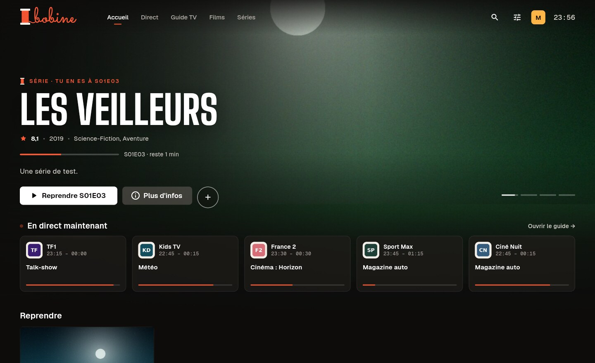
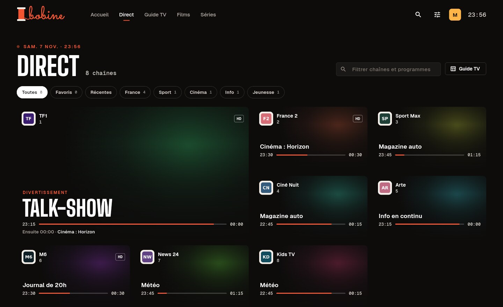
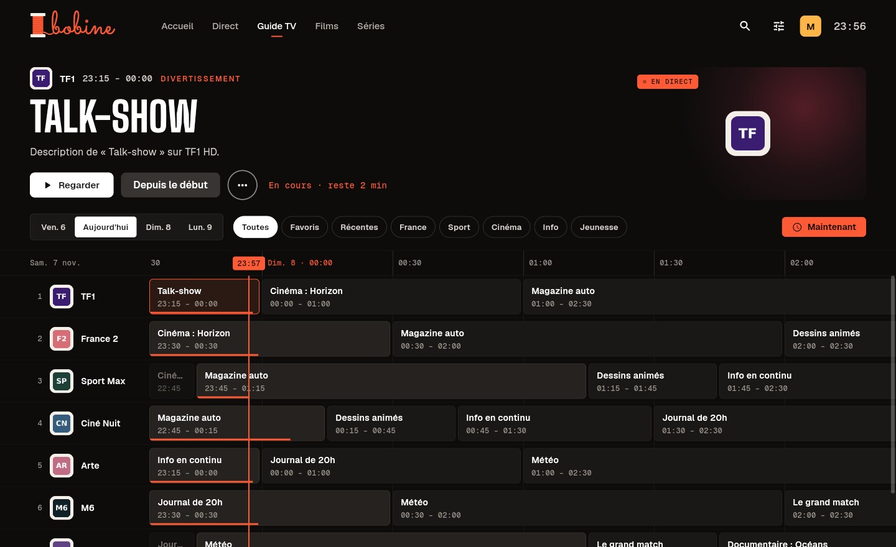
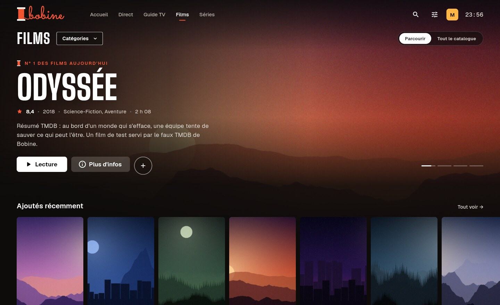
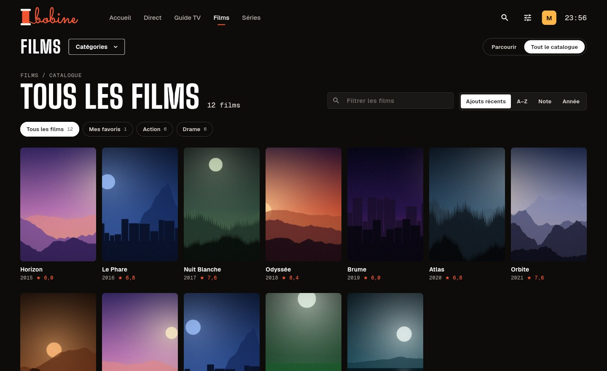
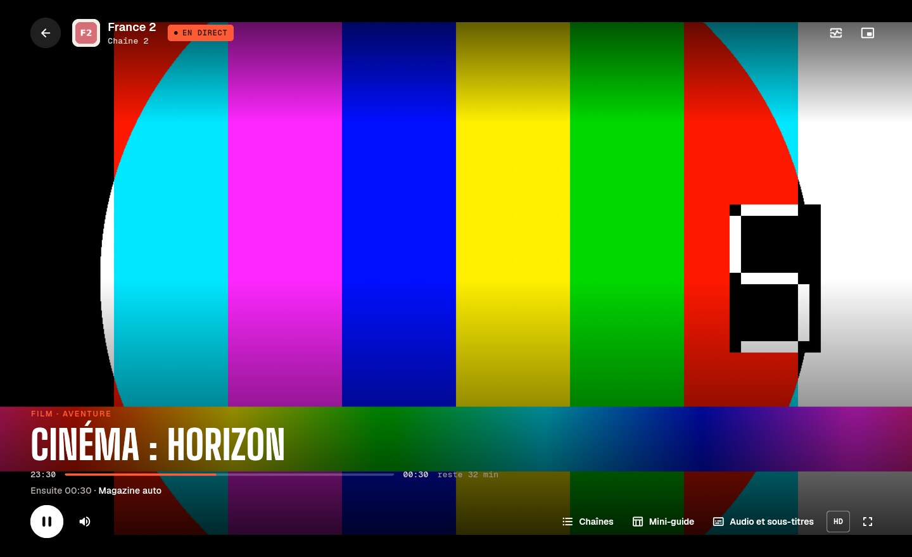
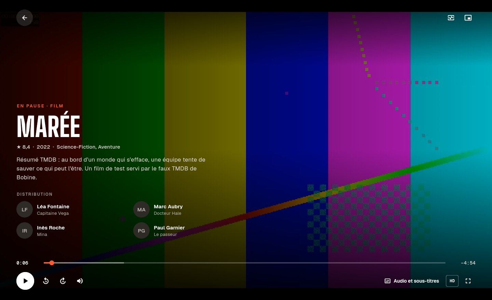
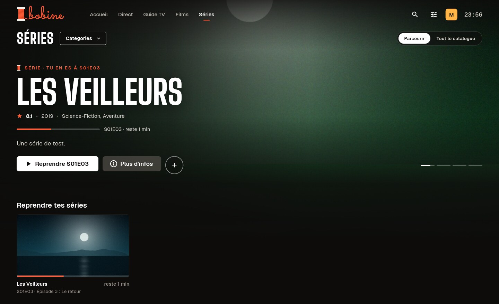
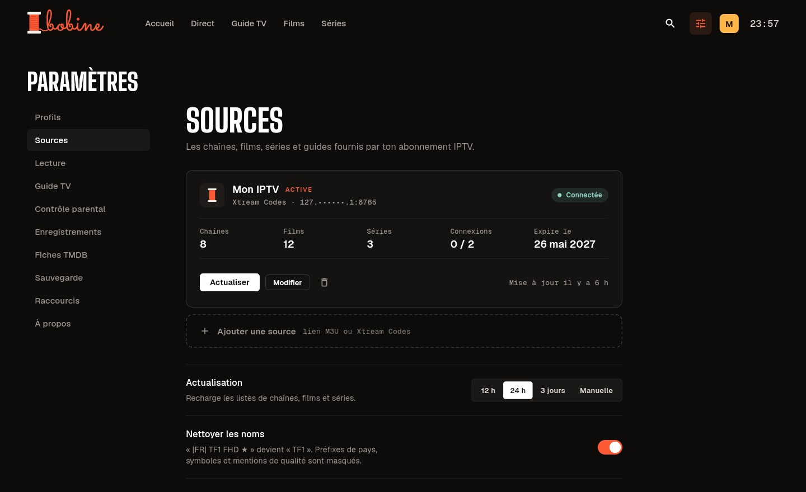

# Bobine — lecteur IPTV desktop

> Anciennement *Lumen*. La mise à jour vers Bobine reprend automatiquement les données (sources, profils, favoris, progression) et remplace l'ancienne application.

Lecteur IPTV pour **Windows, macOS et Linux**, construit avec Flutter et le moteur vidéo **libmpv** (via [media_kit](https://github.com/media-kit/media-kit)).
L'objectif : un lecteur **très optimisé**, qui lit à peu près tous les flux et sur lequel les avances / retours rapides sont instantanés.



| Direct | Guide TV |
|---|---|
|  |  |
| **Films · Parcourir** | **Tout le catalogue** |
|  |  |
| **Lecteur en direct** | **Film en pause** (résumé et distribution) |
|  |  |
| **Séries** | **Paramètres** |
|  |  |

*(Captures réalisées avec le faux serveur de test fourni dans `tool/`, d'où les mires de couleur.)*

---

## Fonctionnalités

**Sources**
- Comptes **Xtream Codes** (serveur + identifiant + mot de passe). Coller un lien `get.php?username=…&password=…` remplit les champs automatiquement.
- Playlists **M3U / M3U8** (URL ou fichier local), y compris compressées en gzip. Les films et séries d'une playlist M3U sont détectés automatiquement (`/movie/`, `/series/`, extensions vidéo, `S01E02`).
- Plusieurs sources, avec bascule rapide depuis le menu du profil.
- Bouton « Tester » (Xtream : statut du compte, date d'expiration, nombre de connexions).
- User-Agent personnalisable avec des préréglages (VLC, Kodi, IPTV Smarters…) pour les fournisseurs qui l'exigent.

**TV en direct**
- Navigation par une barre en haut : Accueil, Direct, Guide TV, Films, Séries, plus recherche (Ctrl + K ou /), paramètres, profil et heure.
- **Direct** en mosaïque : une tuile par chaîne avec le programme en cours, sa progression et la suite ; groupes en pastilles, favoris, chaînes récentes, filtre sur les chaînes **et les programmes**.
- **Noms nettoyés** (« |FR| TF1 FHD ★ » → « TF1 ») et **qualités regroupées** : une seule tuile pour les flux FHD, HD et SD d'une chaîne, la qualité préférée est lancée (réglable).
- **Guide TV** en grille (XMLTV, `.xml` ou `.xml.gz`), virtualisé pour rester fluide avec des milliers de chaînes. L'EPG est associé par `tvg-id` puis par nom de chaîne normalisé (`FR: TF1 HD` ↔ `TF1`).
- Avec Xtream sans EPG XMLTV : repli automatique sur `get_short_epg`.
- **Décalage du guide** réglable par source (−12 h à +12 h), pour les fournisseurs qui publient un guide avec un mauvais fuseau horaire.
- En plein écran : zapping ↑/↓, saisie du numéro de chaîne, liste latérale des chaînes (C).
- **Pause et retour en arrière sur le direct**, dans la limite du cache arrière.
- **Reconnexion automatique** si le flux coupe, et relance d'une chaîne bloquée en chargement plus de 20 s.

**Films et séries**
- « Parcourir » : grande image à la une qui défile, rangées (reprendre, ajouts, Top 10, favoris, catégories, mieux notés) ; un clic lance la lecture, l'affiche survolée propose lecture, favori et fiche.
- « Tout le catalogue » : affiches, catégories (menu en colonnes ou pastilles), tri (ajouts récents, A–Z, note, année), filtre ; catégorie verrouillée déverrouillable sur place avec le code parental.
- Fiches détaillées (synopsis, casting, durée, fond) récupérées depuis Xtream.
- **Reprise de lecture** automatique, « Continuer à regarder » sur l'accueil.
- Saisons et épisodes, épisodes vus, **épisode suivant automatique** avec compte à rebours.

**Lecteur**
- En direct : programme en cours en grand, « Ensuite », panneau **Chaînes** pour zapper, **Mini-guide** des quatre prochains programmes, choix de la **qualité** de la chaîne, badge « Différé » et « Revenir au direct ».
- Films et séries : barre de lecture, **écran de pause** avec résumé et distribution (TMDB), panneau **Épisodes**, « Passer l'intro », carte « Épisode suivant ».
- Panneau **Audio et sous-titres** : pistes (langue préférée, `fr` par défaut), taille des sous-titres, vitesse, format d'image (16:9, 4:3, 21:9, remplir, étirer).
- Statistiques en direct (touche I) : codec, résolution, décodage matériel ou logiciel, cache, débit réseau, images perdues.
- Désentrelacement automatique pour les chaînes 1080i / 576i.

**Nouveautés 1.2 — Bobine**
- Nouveau nom, nouveau logo et **nouvelle interface** : polices Big Shoulders et Geist, vermillon sur fond chaud, accueil façon salle de cinéma, Direct en mosaïque, guide redessiné, lecteur et paramètres refaits.
- Recherche dans l'en-tête (chaînes, programmes, films, séries, recherches récentes et tendances).
- Clic droit sur les vignettes : actions rapides (favori, lancer une saison, marquer comme vu, bande-annonce…).

**Nouveautés 1.1**
- **Mini-lecteur** (touche P) : la vidéo continue dans un coin pendant que tu navigues ; double-clic pour revenir en plein écran. Sous Windows, **fenêtre flottante** toujours au-dessus des autres applications (touche O).
- **Replay** des chaînes qui le proposent (Xtream `tv_archive`, M3U `catchup`) : « Depuis le début » sur le direct, « Revoir » sur un programme passé du guide.
- **Rappels** (« Me le rappeler ») et **enregistrements** (maintenant ou programmés depuis le guide) dans `Vidéos\Bobine`.
- **Recherche dans le guide TV** : les programmes à venir et en cours apparaissent dans la recherche.
- **Profils** (« Qui regarde ? ») avec favoris, reprises et rappels séparés, profil enfant.
- **Contrôle parental** : code à 4 chiffres, catégories adultes verrouillées automatiquement.
- **Ranger les catégories** (masquer, verrouiller, réordonner) et masquer des chaînes (clic droit).
- **Fiches enrichies TMDB** (clé gratuite à saisir dans *Paramètres → Fiches TMDB*) : grandes images, résumé en français, distribution, bande-annonce.
- **Sauvegarde / restauration** des données dans un fichier, avec ou sans identifiants.
- **Diagnostic** : versions, stockage, test de connexion, journal, rapport à copier sans identifiants.
- **Télécommande et manette** (Xbox / XInput sous Windows) : navigation aux flèches avec focus visible, A = ouvrir, B = retour.
- **Installateur Windows** et **mise à jour intégrée** depuis les Releases GitHub.

---

## Pourquoi le lecteur est rapide

Le cœur est **libmpv**, le moteur du lecteur mpv, basé sur FFmpeg. Il lit quasiment tous les formats (H.264, HEVC, AV1, MPEG-2, AC3/E-AC3, DTS, MKV, TS, HLS…) avec **décodage matériel** : D3D11 sous Windows, VideoToolbox sous macOS, VA-API/NVDEC sous Linux.

Pour que **les sauts de 10 ou 15 s soient instantanés** (`lib/player/player_service.dart`) :

| Réglage mpv | Effet |
|---|---|
| `demuxer-max-bytes` = 1 Go (réglable), `cache-secs` très élevé | Le film est téléchargé **en avance, aussi vite que le réseau le permet**. Avancer de 10 s, c'est retomber sur des données déjà présentes. |
| `demuxer-max-back-bytes` = 384 Mo | Ce qui a déjà été vu reste en cache : **reculer est instantané**. |
| `demuxer-seekable-cache=yes`, `force-seekable=yes` | mpv saute *dans* le cache sans nouvelle requête réseau, y compris sur les flux TS. |
| `cache-on-disk=yes` | Le gros cache est stocké sur le disque et ne consomme pas la RAM. |
| `stream-lavf-o=reconnect…,multiple_requests=1` | Connexions HTTP persistantes (les sauts hors cache réutilisent la connexion) et reconnexion automatique si le serveur coupe. |
| Saut relatif `seek ±N relative+exact` | Les appuis répétés sur → s'additionnent correctement et tombent à l'image près. |

La barre de progression affiche **les zones déjà en cache** (gris clair), et un badge **« Cache +02:15 »** indique combien de temps est déjà téléchargé devant la lecture.

Mesures (test `test/scale_test.dart`, 100 000 entrées) :

| Étape | Temps |
|---|---|
| Import d'une playlist M3U de 100 000 entrées | ~2 s |
| Import d'un guide XMLTV de 2 000 chaînes (~250 000 programmes) | ~4 s |
| Afficher les 60 000 films d'un coup | ~0,25 s |
| Recherche globale | < 20 ms |
| « En cours » pour 100 chaînes | < 10 ms |

Autres optimisations :
- **Un seul lecteur pour toute l'application** : pas de recréation du moteur ni de la texture GPU entre deux chaînes, et l'aperçu passe en plein écran sans coupure.
- **Imports en arrière-plan** (isolates Dart) : une playlist de 100 000 entrées ne bloque jamais l'interface. Le guide XMLTV est lu par un analyseur en flux maison, bien plus rapide qu'un parseur XML générique.
- **SQLite indexé** (WAL, mmap) : listes, recherche (sans accents) et guide instantanés.
- **Images** décodées à la taille d'affichage (peu de RAM), cache disque, téléchargements limités en parallèle.

---

## Installation sur Windows

### Option rapide : télécharger l'application déjà compilée

Chaque envoi de code est compilé automatiquement sur un Windows de GitHub (tests compris) :

1. Sur GitHub, ouvre l'onglet **Actions**, puis la dernière exécution **« Build »** réussie (coche verte).
2. En bas de la page, télécharge l'artefact **`Bobine-Setup`** (installateur, sans droits administrateur) ou **`Bobine-windows-x64`** (version portable à dézipper). Il faut être connecté à GitHub.
3. Lance **`Bobine-Setup-x.y.z.exe`**, ou dézippe l'archive et lance **`bobine.exe`**.

Pour publier une version, mets à jour `version:` dans `pubspec.yaml` et `kAppVersion` dans `lib/core/version.dart` (un test vérifie qu'ils sont identiques), puis fusionne dans `main` : si cette version n'existe pas encore, le CI crée le tag (`v1.1.0`) et publie l'installateur et l'archive dans les **Releases**. Pousser soi-même un tag `v*` fonctionne aussi. Les applications installées proposent ensuite la mise à jour (*Paramètres → À propos*).

> La vérification des mises à jour interroge l'API publique de GitHub : le dépôt (ou au moins ses Releases) doit être public.

### Option développeur : compiler toi-même

#### 1. Prérequis (une seule fois)

1. **Git** : https://git-scm.com/download/win
2. **Visual Studio 2022 Community** : https://visualstudio.microsoft.com/fr/downloads/
   À l'installation, coche la charge de travail **« Développement Desktop en C++ »**.
3. **Flutter SDK** (version 3.47 ou plus récente) : https://docs.flutter.dev/get-started/install/windows/desktop
   Décompresse-le par exemple dans `C:\dev\flutter` et ajoute `C:\dev\flutter\bin` au `PATH`.
4. Active le **Mode développeur** de Windows (nécessaire aux plugins Flutter) :
   *Paramètres → Système → Espace développeurs → Mode développeur*.
5. Vérifie l'installation dans un terminal :
   ```powershell
   flutter doctor
   ```
   Les lignes « Windows Version » et « Visual Studio » doivent être cochées.

#### 2. Récupérer et lancer le projet

```powershell
git clone https://github.com/Weder77/IpiTivi.git
cd IpiTivi
git checkout claude/iptv-app-optimized-x5x5g8
flutter pub get
flutter run -d windows          # lance l'app en mode développement
```

> La première compilation télécharge libmpv (~9 Mo) et SQLite : une connexion internet est nécessaire.

#### 3. Créer l'application finale

```powershell
flutter build windows --release
```

L'application se trouve dans `build\windows\x64\runner\Release\`. Copie **tout le dossier** (le `.exe` a besoin des DLL à côté de lui) où tu veux, puis lance `bobine.exe`.

### macOS / Linux

- **macOS** : Xcode requis, puis `flutter run -d macos`.
- **Linux** : `sudo apt install libgtk-3-dev libmpv-dev mpv clang cmake ninja-build pkg-config`, puis `flutter run -d linux`.

---

## Utilisation

1. Au premier lancement, ajoute une source **Xtream Codes** ou **M3U** puis clique sur **« Ajouter et importer »**.
2. Les chaînes, films et séries sont importés en arrière-plan, suivis du guide TV. La progression s'affiche en bas de la fenêtre.
3. Les sources sont actualisées automatiquement (contenu toutes les 24 h, guide toutes les 12 h, réglable).

### Raccourcis du lecteur

| Touche | Action |
|---|---|
| Espace / K | Lecture / pause |
| ← / → | Reculer / avancer (10 s par défaut, Maj = ×6) |
| ↑ / ↓ | Chaîne précédente / suivante (direct), volume (films) |
| Pg↑ / Pg↓ | Chaîne précédente / suivante |
| 0–9 | Aller au numéro de chaîne |
| C | Panneau des chaînes (direct) |
| G | Mini-guide (direct) |
| E | Épisodes (série) |
| F, F11, double-clic | Plein écran |
| M, molette | Muet, volume |
| A / S | Piste audio / sous-titres suivants |
| R | Format d'image |
| N | Épisode suivant |
| I | Statistiques |
| P | Mini-lecteur |
| O | Fenêtre flottante (Windows) |
| Échap | Quitter le plein écran / retour |

Hors du lecteur, les **flèches** déplacent le focus (cartes, menus, boutons), **Entrée** ouvre et **Échap** revient. Un **clic droit** (ou la touche Menu) sur une vignette ouvre ses actions rapides : lecture ou reprise, depuis le début, lancer une saison, favoris, marquer comme vu, bande-annonce, retirer de « Reprendre », enregistrer ou masquer une chaîne. Une manette Xbox fait de même : croix ou stick pour se déplacer, **A** valider, **B** retour, **X** pause, **Y** actions rapides (plein écran dans le lecteur), **LB / RB** page précédente / suivante.

### En cas de problème

- **Une chaîne ne se lance pas** : dans *Paramètres → Sources → Modifier → Options avancées*, essaie le format **HLS** au lieu de MPEG-TS, ou un **User-Agent** (VLC).
- **Image corrompue ou verte** : passe le **décodage vidéo** sur « Logiciel » (*Paramètres → Lecture*).
- **Effet de peigne** sur certaines chaînes : désentrelacement sur « Toujours ».
- **Petit SSD ou peu de RAM** : choisis une **mémoire tampon** « Faible » (*Paramètres → Lecture*).
- **Programmes du guide décalés d'une heure ou plus** : *Paramètres → Sources → Modifier → Options avancées → Décalage du guide TV*.
- **Autre souci** : *Paramètres → Sauvegarde → Diagnostic* teste la connexion à chaque source et affiche le journal ; « Copier le rapport » donne un texte sans mot de passe à partager.

---

## Données et vie privée

Tout est stocké **localement** dans une base SQLite (`bobine.db`) : sources, profils, favoris, progression, rappels et réglages. Un journal (`bobine.log`, identifiants masqués) se trouve à côté.
Sous Windows elle se trouve dans `%APPDATA%\com.bobine\Bobine\`. Aucune donnée n'est envoyée ailleurs que vers ton fournisseur IPTV, sauf ce que tu actives : les titres des films et séries ouverts vers TMDB si tu as saisi une clé, et la vérification des mises à jour vers GitHub (désactivable).

Sous Windows, les **mots de passe et URL contenant des identifiants sont chiffrés** avec DPAPI (liés à ton compte Windows) : une copie de `bobine.db` est illisible sur un autre compte ou un autre PC. Les identifiants sont aussi masqués dans les messages d'erreur. La taille et la position de la fenêtre sont mémorisées dans `HKCU\Software\Bobine`.

Bobine est un lecteur : il ne fournit aucun contenu.

---

## Architecture

```
lib/
├── main.dart, app.dart, services.dart   Démarrage, thème, conteneur de services
├── core/            Texte (accents, hash), réseau (HTTP, gzip), formats, thème
├── data/
│   ├── db.dart              Schéma SQLite et migrations
│   ├── models.dart          Source, Channel, Movie, Series, Episode, Program…
│   ├── repository.dart      Requêtes (favoris, progression, recherche, EPG)
│   ├── settings.dart        Préférences utilisateur
│   ├── epg_cache.dart       Association chaîne ↔ guide, « en cours » mémorisé
│   └── import/              M3U, Xtream, XMLTV : analyse en flux + import en isolate
├── player/
│   ├── player_service.dart  Instance libmpv unique + stratégie de cache
│   ├── player_screen.dart   Lecteur plein écran (commandes, raccourcis, zapping)
│   ├── player_chrome.dart   Barres, panneaux (chaînes, mini-guide, pistes, épisodes), écran de pause
│   └── player_widgets.dart  Noms des pistes audio et sous-titres
└── ui/              Accueil, Direct + guide, Films/Séries, fiches, recherche, paramètres
test/                Tests (analyseurs, import complet avec faux serveur, lecteur, images)
tool/                Faux serveur Xtream + générateur de vidéos de test
```

### Tester sans abonnement

```bash
tool/generate_test_media.sh test_media      # nécessite ffmpeg + ImageMagick
python3 tool/fake_xtream.py test_media 8765
```

Puis dans Bobine, ajoute une source Xtream avec le serveur `http://127.0.0.1:8765` (identifiant et mot de passe quelconques).

### Tests

```bash
flutter analyze
flutter test
```

---

## Feuille de route

- [ ] **Synchronisation par compte** (favoris, progression, sources) entre plusieurs appareils. Les données utilisateur sont déjà indexées par des identifiants stables et horodatées pour la préparer.
- [x] Replay / catch-up, rappels, enregistrements, mini-lecteur, profils, contrôle parental, TMDB, sauvegarde, manette, installateur (1.1).
- [ ] Multi-écran (2 à 4 chaînes).
- [ ] Portail Stalker (MAC).
- [ ] Version Android TV / mobile (même code Flutter + media_kit).
- [ ] Signature de l'installateur Windows (évite l'avertissement SmartScreen).
